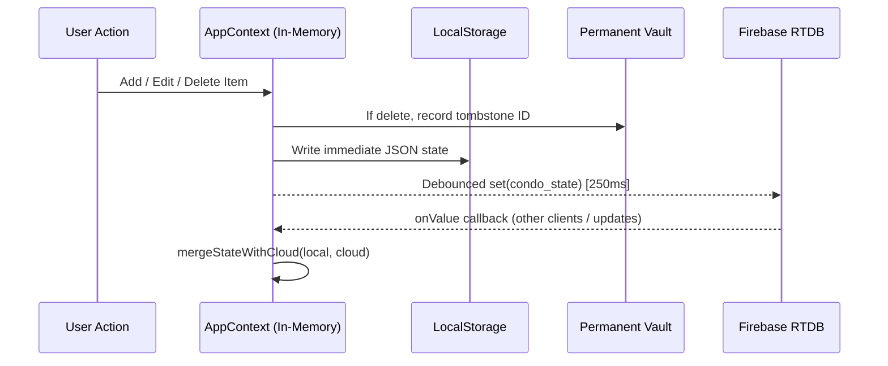

# Architecture & Persistence Specification

This document details the software architecture, component hierarchy, state flow, and 3-tier persistence model of the **Társasházkezelő Portál**.

---

## 1. High-Level System Architecture

```mermaid
graph TD
    subgraph UI_Layer [React UI Tree]
        App[App.jsx - Router, Modals & Error Boundary]
        Header[Header.jsx - Brand, Profile Switcher, Lang Toggle]
        Drawer[IosSideDrawer.jsx - Slide-in iOS Menu]
        LoginView[LoginView.jsx - Credentials & Demo Tiles]
        RoleSelectView[RoleSelectView.jsx - Dual-Role Selection Hub]
        PortfolioView[PortfolioView.jsx - Társasházaim KK Dashboard]
        TenantView[TenantView.jsx - Resident Portal & Bank Ref]
        AdminView[AdminView.jsx - Rep KPIs, Arrears Grid, 8-item Tx Feed, Assembly Tab]
        SuperAdminView[SuperAdminView.jsx - Rep Tree, Email Inspector & Impersonation]
        Modals[Universal Tx Modal, Assembly Modal, Calendar & Tasks Modal, 14 Specialized Modals]
    end

    subgraph State_Layer [Modular Context & Logic Engine]
        AppContext[AppContext.jsx - Central Reactive Store, RTDB Listener & Orchestrator]
        SyncEngine[syncEngine.js - CRDT Merge, Tombstone Vault & Sanitization]
        AuthActions[authActions.js - Zero-Trust Auth, Session & Impersonation]
        AcctActions[accountingActions.js - Financial Mutations, Balances & Clipboard]
        BldgActions[buildingActions.js - Building, Flat & Document Lifecycle]
        CalActions[calendarActions.js - Global & Local Events, Deadlines & Tasks]
        Finances[finances.js - Financial Ledger Engine]
        Assembly[assembly.js - Tht. Assembly Balance Calculator]
        ExportExcel[exportExcel.js - SheetJS Engine & Tht. Reports]
        Sound[sound.js - Audio Feedback Notifications]
    end

    subgraph Storage_Layer [3-Tier Persistence]
        RTDB[(Firebase RTDB: condo_state)]
        LocalStorage[(LocalStorage: tarsashaz_state)]
        Vault[(Permanent Vault: tarsashaz_permanent_vault)]
    end

    App --> AppContext
    Header --> AppContext
    Drawer --> AppContext
    LoginView --> AppContext
    TenantView --> AppContext
    AdminView --> AppContext
    SuperAdminView --> AppContext
    Modals --> AppContext

    AppContext --> SyncEngine
    AppContext --> AuthActions
    AppContext --> AcctActions
    AppContext --> BldgActions
    AppContext --> Finances
    AppContext --> Assembly
    AppContext --> ExportExcel
    AppContext <==>|Debounced write / onValue listener| RTDB
    AppContext <==>|Instant sync on every change| LocalStorage
    AppContext <==>|Tombstone tracking| Vault
```

---

## 2. Component Structure

### 2.1 Shell, Routing & Error Boundary (`src/App.jsx` & `src/main.jsx`)
`App.jsx` acts as the root orchestrator and modal controller:
- **Error Boundary**: `main.jsx` wraps the entire root application in a custom `ErrorBoundary` component, gracefully intercepting any uncaught runtime exceptions and rendering an informative fallback UI instead of crashing to a blank white screen.
- **Authentication & Role Router**:
  1. If `!state.currentUser`, renders `LoginView`. A bejelentkezés közvetlen: a megadott e-mail címhez tartozó regisztrált profil alapján lép be.
  2. If `currentUser.role === 'superadmin'`, renders `SuperAdminView`.
  3. If user is in Common Representative mode (`currentUser.role === 'admin'` or `activeRoleMode === 'kk'`):
     - If at portfolio level (`state.isPortfolioView`), renders `PortfolioView` ("Társasházaim").
     - Otherwise inside an active condominium, renders `AdminView`.
  4. Otherwise (Resident mode `currentUser.role === 'Owner'` or `activeRoleMode === 'tenant'`), renders `TenantView`.
- **Modal Controller**: Holds state for application modals (including `CalendarModal`), ensuring modals open smoothly as glassmorphic overlays over the active view.
- **Deep Linking**: Reads URL search parameters (e.g. `?reset_token=...&email=...`) on mount to automatically trigger password reset flows.

### 2.2 Header (`src/components/Header.jsx`)
- Building identity & brand logo (clicking returns to the main dashboard / portfolio).
- Dynamic subtitle based on role mode (Condominium name or "Társasházaim (Portfólió)").
- Direct mode switcher buttons: "Társasházaim" (return to portfolio), "Saját Lakásom" (switch to resident view), or "Közös Képviselet" (switch to KK portfolio).
- Bilingual toggle flag (`hu` / `en`).
- iOS drawer menu trigger.

### 2.3 Side Drawer (`src/components/IosSideDrawer.jsx`)
- Slide-in glassmorphic drawer matching native iOS navigation.
- Header context button: **"← Társasházaim (Portfólió)"** when in KK mode inside a building.
- Provides routing to:
  1. Main Menu / Dashboard
  2. Naptár és Feladatok (Calendar & Tasks — new module)
  3. A ház pénzügyi helyzete (Financial Situation)
  4. Lakások adatai (Flats Data — Admin only)
  5. Közgyűlés (General Assembly — Admin only)
  6. Hitelek (Loans)
  7. Dokumentumok (Documents)
  8. Profilom (Profile)
  9. Szerepkörváltás ("Saját Lakásom" / "Közös Képviselet" for dual-role users)
  10. Kijelentkezés (Logout)
- Fully responsive with close button (X) and backdrop touch dismiss.

### 2.4 Views (`src/views/`)
- **`LoginView.jsx`**: User email/password form, Remember Me, and 1-click quick login demo tiles.
- **`RoleSelectView.jsx`**: Dual-role landing hub separating "Közös Képviselői Portfólió" from "Saját Lakásom", with flat selector for multi-unit owners.
- **`PortfolioView.jsx`**: Representative multi-building dashboard ("Társasházaim") with aggregate KPIs (total buildings, total flats, combined reserves, total arrears), building cards with arrears status badges, and "+ Új társasház hozzáadása" workflow.
- **`TenantView.jsx`**: Resident dashboard displaying Common Cost (KK) and Renovation Fund (FA) balances, status badges, bank transfer details with copy buttons, and recent transaction ledger.
- **`AdminView.jsx`**: Representative dashboard featuring KK/FA building reserve KPIs, monthly balance margin tracker, interactive Arrears Matrix grid (with quick `+KK` and `+FA` payment actions), and full transaction history.
- **`SuperAdminView.jsx`**: Platform administrator control center with hierarchical tree, email visibility, and impersonation.

### 2.5 Modular Context Architecture (`src/context/`)
A moduláris architektúra 6 specializált logikai egységre tagolódik:
1. **`syncEngine.js`** (Szinkronizáció & CRDT összefésülés):
   - Tiszta függvények a felhőbeli és helyi állapot uniójához (`mergeStateWithCloud`), beleértve a naptáresemények (`calendarEvents`) és szerepkör-beállítások szinkronizálását.
   - Törlési sírkövek (Permanent Vault: `getPermanentVault`, `savePermanentVault`).
   - Binárisok leválasztása hálózati küldés előtt (`stripLargeBinaries`).
   - Firebase RTDB hasznos teher fertőtlenítése (`sanitizeForFirebase`, `createCloudPayload`).
   - Kezdeti állapot hidrálása LocalStorage-ból és alapértelmezett adatokból (`loadInitialState`).
2. **`authActions.js`** (Hitelesítés & Munkamenet):
   - Szigorú zero-trust bejelentkezés jelszó-ellenőrzéssel (`login`), beégetett bypassok nélkül.
   - Gyorsbejelentkezés (`quickLogin`), kijelentkezés (`logout`).
   - SuperAdmin szerepköri megszemélyesítés (`actAsUser`, `exitImpersonation`).
   - Szerepkörváltás (`switchToKkMode`, `switchToTenantMode`, `openPortfolio`, `openBuildingAdmin`).
   - Többlakásos profilváltás (`switchActiveFlat`) és jelszómódosítás (`changePassword`).
3. **`calendarActions.js`** (Naptár & Feladatkezelés):
   - Naptáresemények és határidők létrehozása (`addCalendarEvent`), módosítása (`updateCalendarEvent`), törlése (`deleteCalendarEvent`).
   - Feladatok elvégzésének jelölése (`toggleCalendarEventDone`).
   - Portfólió szintű (összesített) és épület-specifikus szűrés és nézetek támogatása.
4. **`accountingActions.js`** (Pénzügyi műveletek & Könyvelés):
   - Tranzakciók (`addTransaction`), kiadások (`addExpense`), kézi terhelések (`addManualDebit`).
   - Csoportos tételek rögzítése (`addMultipleItems`), módosítás (`editItem`), törlés visszavonhatósággal (`deleteItem`).
   - Globális tartalékok és induló egyenlegek beállítása (`setGlobalBalances`).
   - Előírások módosítása és egyenleg-újraszámítás (`updateFlatFees`).
   - Vágólap és billentyűzetes másolás/beillesztés kezelése (`copyTransaction`, `pasteTransaction`).
5. **`buildingActions.js`** (Épület-, Lakás- és Dokumentum-kezelés):
   - Új épület felvitele adószámmal és kezdőtartalékkal (`addBuilding`), épületváltás (`switchBuilding`), adatmódosítás (`updateBuildingData`, `updateBuildingRepInfo`, `saveInfoSections`).
   - Lakások életciklusa (`addFlat`, `deleteFlat`, `saveFlatMaster`, `resetFlatPassword`).
   - Dokumentumtár kezelése (`uploadDocument`, `deleteDocument`, `fetchDocumentFile`).
6. **`AppContext.jsx`** (Központi Orchestrator & Állapot-kezelő):
   - Atomi állapotgép (`state`, `setState`, `persistState`) és `revision` számláló.
   - Valós idejű Firebase RTDB WebSocket figyelő (`onValue`).
   - Életciklus-figyelők (`beforeunload`, lapébresztés `visibilitychange`).
   - Toast értesítési rendszer (`showToast`, `toasts`).
   - Változatlan `useApp()` és `getUserFlats()` szerződés a komponensek felé (100% visszafelé kompatibilis).

---

## 3. The 3-Tier Persistence Model

Persistence guarantees that data is **always available offline**, **synchronizes instantly across devices**, and **never loses records or resurrects deleted items**.

### Tier 1: Firebase Realtime Database (Primary Cloud Authority)
- **Node**: `condo_state`
- **URL**: `https://tarsashaz-cfe5d-default-rtdb.europe-west1.firebasedatabase.app`
- Connected via official `firebase/database` SDK.
- Active listener `onValue(ref(rtdb, "condo_state"))` provides multi-tab and multi-device real-time synchronization.
- **Payload Sanitization (`sanitizeForFirebase`)**: Firebase RTDB synchronously rejects updates with fatal exceptions if any payload property contains `undefined`. To prevent crashes, all outgoing payloads pass through `sanitizeForFirebase()`, which recursively strips or converts `undefined` to `null` and ensures that all collection arrays (`flats`, `transactions`, `expenses`, `manualDebits`, `documents`) are guaranteed valid arrays.
- **Strict User Mandate**: Automated test scripts are strictly prohibited from writing or deleting live records in the database. Any data modification requires explicit user permission.

### Tier 2: Browser LocalStorage (Zero-Latency Offline Cache)
- **Key**: `tarsashaz_state`
- Holds the complete serialized state of the application.
- Initial app load reads directly from LocalStorage before the first cloud packet arrives, ensuring **instant initial render (0ms visual delay)**.

### Tier 3: Permanent Vault (Deletion Tombstones)
- **Key**: `tarsashaz_permanent_vault`
- Structure: `{ deletedIds: string[], deletedFlatNums: string[], lastUpdated: number }`
- **Critical Problem Solved**: In distributed databases, if Client A deletes an item while offline or during merge, a remote cloud snapshot might still contain that item. The Vault stores permanent tombstones (`deletedIds` and `deletedFlatNums`) so deleted items are **never resurrected** during cloud merges.

---

## 4. Multi-User Concurrency & Revision-First Merging Logic (`mergeStateWithCloud`)

Amikor a Firebase RTDB-ből új adatcsomag érkezik, az `AppContext` kétirányú, adatvesztés-mentes (CRDT-jellegű), **revízió-vezérelt** összefésülést hajt végre:

1. **Szigorú Revízió-Elsőbbség (`cloudRev >= localRev`)**:
   - A gépek közötti döntőbíró a **revíziószám (`revision`)**, nem a helyi laptopok bizonytalan belső órája (`Date.now()`).
   - Ha a felhőbeli revízió nagyobb vagy egyenlő (`cloudRev >= localRev`), a felhő az abszolút forrás: a ház számlafőösszegei, felújítási alapja, lakásadatai és előírásai azonnal és feltétel nélkül átvételre kerülnek.
   - Helyi adatok csak akkor élveznek elsőbbséget, ha a helyi gép offline módban végzett szerkesztéseket (`localRev > cloudRev`).
2. **Kétirányú Entitás-Unió (`mergeItemArray`)**:
   - **Tranzakciók, kiadások, terhelések, dokumentumok**: A helyi és a felhőbeli tömbök elemei egyedi azonosító (`id`) alapján egyesülnek egy `Map`-ben.
   - **Nincs tétel-elhullás**: Bármelyik kliens által újonnan hozzáadott elem automatikusan bekerül a végleges állapotba.
   - **Azonos tétel feloldása**: Ha mindkét helyen létezik az azonosító, a felhőbeli verzió érvényesül (`isCloudAuthoritative`).
   - **Törlések védelme**: A Permanent Vault `deletedIds` halmaza kiszűri a törölt elemeket, megelőzve az újraéledést.
3. **Lakásadatok Összefésülése (`mergeFlatsArray`)**:
   - `flatNum` alapján egyesíti a lakásokat, a sztornózott előírások (`cancelledDebits`) uniójával.
   - A felhő felülbírálja a helyi gyorsítótár elavult lakásadatait.
4. **Kliensoldali Műveletek Elkülönítése (`localOnly` Mód)**:
   - A bejelentkezés, kijelentkezés, szerepkör-megszemélyesítés, nyelvváltás és lakásváltás **helyi munkamenet-művelet** (`immediateCloud = 'localOnly'`).
   - Ezek nem növelik a revíziót, és nem küldenek adatbázis-írást a felhőbe, így kizárt, hogy egy belépő eszköz felülírja a felhő éles könyvelési adatait.
5. **Kezdeti Szinkronizációs Pajzs (`InitialLoadingScreen`)**:
   - Meglévő munkamenet esetén az alkalmazás az adatok felhőből történő beérkezéséig töltőképernyőt mutat.
   - A bejelentkezési űrlap beküldésekor a felület előbb lehívja a felhő legfrissebb állapotát, és csak utána engedi be a felhasználót a műszerfalra.

---

## 5. Network Lifecycle, Immediate Sync & Flush Listeners

A zökkenőmentes, azonnali mentés és többeszközös működés alapjai:
- **Azonnali Felhőmentés (`immediateCloud = true`)**: Minden könyvelési művelet (befizetés, kiadás, előírás, szerkesztés, törlés) késleltetés (debounce) nélkül, azonnal elküldi a csomagot a Firebase RTDB felé.
- **Kilépési és Ablakváltási Pufferürítés (`blur`, `pagehide`, `beforeunload`)**: Ha a felhasználó átvált egy másik ablakra (pl. inkognitó fülre), az ablak azonnal elküldi az esetleges függőben lévő mentéseket, megelőzve az adatvesztést.
- **Védett Ébresztési Mechanizmus (`handleWake`)**:
  - `focus`, `online`, és `visibilitychange` eseményeknél a rendszer lekéri a legfrissebb felhő állapotot, de **soha nem szakítja meg** a folyamatban lévő helyi írást (`isCloudSyncingRef.current`).
  - Az új, kétirányú `mergeStateWithCloud` összefésüléssel az ablak visszahozásakor a friss helyi adatok nem íródnak felül a felhővel, hanem összefésülődnek és frissítik a helyi tárhelyet is.

---

## 6. Initial Cloud Guard & Anti-Wipe Protection

To prevent an empty client state from accidentally wiping an existing cloud database on first boot:
- The app initializes with `cloudInitialSyncDoneRef.current = false`.
- **Anti-Wipe Guard**: Ha a felhő üres, a kliens csak akkor inicializálhatja alapértelmezett adatokkal, ha a helyi állapot valóban érvényes és szerkesztett (`s.revision > 0 && s.lastUpdated > 0`). Ezzel megakadályozható, hogy egy tiszta lappal induló böngésző (pl. privát/inkognitó fül vagy új mobilkliens `revision: 0` értékkel) felülírja a felhőt üres/kezdeti adatokkal.
- **Kanonikus Adatcsomag (`createCloudPayload`)**: Minden felhőbe küldött állapotmentés egységes csomagot hoz létre, amely tartalmazza a gyökér szintű `buildings`, `users`, `vault`, `revision`, `lastUpdated` mezőket, valamint az aktív épület szétterített tulajdonságait (`transactions`, `expenses`, `flats`, `documents`), megelőzve a hiányos mentéseket.
- Ha a felhőben már létezik adat, a kliens átveszi és összefésüli (`mergeStateWithCloud`), mielőtt bármilyen írási művelet engedélyezetté válna.
- **Authoritative Auto-Push**: Ha a kliens helyi revíziója magasabb, mint a felhőé (`localRevision > cloudRevision`), a rendszer a hitelesített munkamenet ellenőrzése után automatikusan feltölti a friss helyi adatokat a felhőbe.

---

## 7. Session Restoration & Real-Time Sync State Tracking

1. **Háttérbeli Hitelesítés-helyreállítás (`ensureFirebaseAuth`)**:
   - Amikor az alkalmazás elindul és a `localStorage`-ben tárolt "Emlékezz rám" adatokból (`tarsashaz_logged_in_user`) helyreállítja a bejelentkezett felhasználót, a háttérben automatikusan újra bejelentkezik a Firebase Auth Identity Platformra (`signInWithEmailAndPassword`).
   - Ez biztosítja, hogy a Firebase RTDB felé nyitott WebSocket kapcsolat megkapja az érvényes `auth != null` JWT tokent, megszüntetve a csendes `PERMISSION_DENIED` elutasításokat.
2. **Valós Idejű Állapotgép (`cloudSyncStatus`)**:
   - Három állapot: `'synced'` (Naprakész), `'syncing'` (Mentés folyamatban), `'error'` (Hiba a mentés során).
   - Ha a hálózat vagy jogosultság miatt a Firebase írás meghiúsul, a `cloudSyncStatus` azonnal `'error'` állapotba vált, és rögzíti a pontos hibát (`cloudSyncError`).
   - A `CloudSyncBadge.jsx` azonnal megjeleníti az amber/piros figyelmeztető jelzést, és egykattintásos kényszerített újraszinkronizálást (`forceSyncLocalToCloud`) biztosít a felhasználónak.

---

## 8. Payload Optimization, Echo-Loop Elimination & File Storage Separation (`condo_files`) (2026.10.11)

### 8.1 The 3.3 MB Monolithic State Hazard
Korábban a feltöltött dokumentumok (`documents`) és tájékoztató mellékletek (`infoSections`) több megabájtos Base64 kódolású bináris tartalmai közvetlenül beágyazva szerepeltek a `condo_state` objektumban:
- Egyetlen lakás előírásának mentése vagy egy 15 000 Ft-os befizetés rögzítésekor a rendszer a teljes 3,3 MB-os állapotot (sőt, a korábbi gyökér duplikációval ~6,6 MB-ot) küldte el a felhőbe minden mentésnél.
- Ez átlagos feltöltési sávszélességen 5–15 másodpercig tartó szinkronizálást és folyamatosan forgó szinkronizálási ikont eredményezett.

### 8.2 Szinkronizációs Visszhang-Ciklus Megszüntetése
A valós idejű figyelőben (`setupRtdbListener` és `handleWake`) azonosított logikai hiba (`localRevision >= cloudRevision`) miatt a kliens minden beérkező, sikeresen elmentett felhő válasznál azt hitte, hogy újra el kell küldenie az állapotot, ami végtelen duplikált mentési ciklust és hálózati torlódást okozott.
- **Megoldás**: Szigorú `localRevision > cloudRevision` feltétel bevezetése. A kliens kizárólag akkor küld állapotot felhőbe, ha lokálisan újabb, offline szerkesztett adatokkal rendelkezik.
- A `mergeStateWithCloud` passzív összefésülésekor a revíziószám nem nő automatikusan (`merged.revision = Math.max(localRev, cloudRev)`).

### 8.3 Különálló Bináris Fájlkezelés (`condo_files`)
A nagyméretű fájlok bináris adatai leválasztásra kerültek a napi könyvelési állapotról:
1. **Dedikált felhő csomópont**: A fájlok a `condo_files/${id}` útvonalon tárolódnak (a `database.rules.json` hitelesített szabályaival védve).
2. **Könnyűsúlyú könyvelési állapot**: A `condo_state` kizárólag a dokumentumok metaadatait (`title`, `fileName`, `fileSize`, `fileType`, `uploadDate`, `hasFile`) tárolja.
3. **99,4%-os méretcsökkenés**: Az adatbázis állapota 3 300 KB-ról mindössze **~20 KB-ra** csökkent.
4. **Töredékmásodperces mentés**: Bármilyen könyvelési tétel, egyenleg vagy megjegyzés mentése **0,02–0,05 másodperc (20–50 ms)** alatt lefut.
5. **Igény szerinti letöltés**: A dokumentumok letöltése a `fetchDocumentFile(docId)` függvénnyel a letöltés pillanatában, közvetlenül a tárolóból történik.
6. **LocalStorage kvótavédelem**: A `stripLargeBinaries` függvény garantálja, hogy a böngésző 5 MB-os helyi tárhelye soha ne teljen be bázisadatokkal.

---

## 9. Számlafőösszeg és Induló Tartalék Perzisztencia Védelem (2026.10.11)

### 9.1 Az Anomália Háttere és Kiváltó Okai
A felhasználó által jelzett jelenség: a számlafőösszeg módosítását (`GlobalBalancesModal`) követően az oldal a mentéskor azonnal a jó összeget mutatta, azonban oldalfrissítés (F5) után vagy röviddel utána visszaváltott a korábbi értékre (vagy 0 Ft-ra).

**A részletes ok-okozati lánc feltárása:**
1. **Csendes Hitelesítési Kimaradás (`ensureFirebaseAuth`)**:
   - A `persistState` futásakor a `syncToCloud` megkísérelte a felhőbe írást.
   - Ha a Firebase Auth munkamenet épp nem volt aktív (pl. az `auth.currentUser` még nem inicializálódott), a rendszer a háttérbeli `ensureFirebaseAuth`-t hívta meg.
   - Ez korábban szigorúan megkövetelte a `rememberMe === "true"` kulcsot a `localStorage`-ben, és a modern Firebase Auth v10+ által küldött `auth/invalid-credential` hibakódot nem kezelte egységesen.
   - Ennek következtében a felhőmentés elmaradt (`Cloud sync skipped: User is not authenticated`), miközben a kliens a böngésző helyi `LocalStorage`-ébe azonnal elmentette a módosított állapotot.
2. **Oldalfrissítés Kétlépcsős Felülírása**:
   - A lap újratöltésekor a `loadInitialState` szinkronban beolvasta a `LocalStorage`-t: ekkor a felületen megjelent a módosított egyenleg ("utána egy kicsit még jó").
   - Ezt követően (150–500 ms múlva) a Firebase RTDB `onValue` figyelője megérkezett a felhőbeli állapottal, ahol a tartalék még 0 Ft-on állt.
   - A korábbi `mergeStateWithCloud` a felhő időbélyegét (`cloudTime > localTime`) véve felülírta a helyi tartalékot a felhő 0 értékével ("aztán visszavált").

### 9.2 Az Alkalmazott Rendszerszintű Védelem (Phase 0 Frissítve)
1. **Szigorú Firebase Auth SDK Perzisztencia (`ensureFirebaseAuth` -> `auth.authStateReady()`)**:
   - A korábbi több-jelöltes kliensoldali újrahitelesítés biztonsági okokból megszüntetésre került (soha nem tárolunk és nem küldünk beégetett jelszavakat).
   - Az `ensureFirebaseAuth` közvetlenül a Firebase Auth SDK hivatalos munkamenet-állapotára (`auth.authStateReady()`, `browserLocalPersistence` / `browserSessionPersistence`) támaszkodik; érvényes Firebase Auth JWT token hiányában a felhőírás elutasításra kerül és a felhasználó újra bejelentkezhet.
2. **Előzetes Hitelesítés és Időbélyeg-Szinkronizáció (`setGlobalBalances`)**:
   - A `setGlobalBalances` aszinkron módon lefutva ellenőrzi az érvényes Firebase kapcsolatot a mentési ciklus megkezdése előtt.
   - Mind a gyökérállapot, mind az aktív épület egyidejűleg megkapja az új `lastUpdated` időbélyeget és a frissített induló tartalékokat (`buildingInitialReserveCommon`, `buildingInitialReserveRenovation`).
3. **Kettős Felhő-Payload Integritás (`createCloudPayload`)**:
   - A `createCloudPayload` biztosítja, hogy a felhő csomópont gyökerében és a `buildings[0]` épülettömbben található tartalékértékek szigorúan megegyezzenek.
4. **Intelligens Összefésülés (`mergeStateWithCloud`)**:
   - Épületszintű időbélyeg-összehasonlítás (`cbBuildingTime` vs. `mbBuildingTime`).
   - Szigorú aszimmetrikus védelem: felhőbeli 0 Ft vagy hiányzó mező **soha nem írhatja felül** a lokálisan frissen beállított számlafőösszeget.
5. **Authoritative Push Feltétel (`setupRtdbListener` & `handleWake`)**:
   - Ha a kliensen újabb helyi számlafőösszeg található, a figyelő beérkezésekor azonnal felküldi az authoritative állapotot a felhőbe, így a felhőbeli adatbázis is garantáltan felveszi a valós egyenleget.

---

## 10. Azonnali Felhőmentés és Lapbezárás Elleni Védelem (`beforeunload`) (2026.10.11)

### 10.1 Mi történik, ha a felhasználó rögzít egy adatot és azonnal bezárja az oldalt?
Három védelmi vonal garantálja a 100%-os adatbiztonságot:

1. **Azonnali Szinkron Helyi Írás (`LocalStorage`)**:
   - Amikor a felhasználó a "Mentés" gombra kattint, a `persistState` legelső lépésként szinkron módon (< 2 ms) beleírja a teljes állapotot a böngésző merevlemezen lévő `LocalStorage` tárhelyébe (`tarsashaz_state`).
   - Még áramszünet vagy a böngésző azonnali kilövése (Task Manager) esetén sem vész el az adat: amint a felhasználó legközelebb megnyitja az oldalt, a `setupRtdbListener` észleli a magasabb helyi revíziót (`localRevision > cloudRevision`), és azonnal felküldi a felhőbe.

2. **Ultra-Gyors Hálózati WebSocket Írás (15–40 ms)**:
   - A nagyméretű PDF binárisok leválasztása után az aktív állapot mérete mindössze ~20 KB.
   - Az élő Firebase RTDB WebSocket kapcsolaton az adatbázis-mentés átlagosan **15–40 milliszekundum** alatt megérkezik a Google szervereire és megkapja a megerősítést — gyorsabban, mint ahogy egy ember a Mentés gomb megnyomása után fel tudja vinni az egeret a lap X gombjára.

3. **Aktív Műveleti Retesz (`beforeunload` & `pagehide`)**:
   - Ha a felhasználó egy lassabb hálózaton vagy azonnali gyorsbillentyűvel (`Ctrl+W`) zárná be a böngészőt, miközben a felhőmentés éppen hálózati átvitel alatt van (`isCloudSyncingRef.current === true` vagy `pendingCloudSyncFnRef.current !== null`):
   - A `window.addEventListener("beforeunload")` eseménykezelő megállítja a bezárást (`e.preventDefault()`, `e.returnValue = msg`), és megjeleníti a böngésző natív megerősítő figyelmeztetését ("A mentés folyamatban van a felhőbe. Biztosan elhagyja az oldalt?").
   - Ez a rövid megállítás biztosítja a háttérben futó JavaScript szál és a WebSocket számára a szükséges töredékmásodpercet a sikeres szerveroldali rögzítéshez. Amint az adat megérkezett, a retesz azonnal felold, a szinkronizációs jelvény "Naprakész"-re vált, és a lap biztonságosan bezárható figyelmeztetés nélkül.
   - A `persistState` emellett Promise-t ad vissza, így a moduláris műveletek szükség esetén közvetlenül megvárhatják (`await persistState(...)`) a felhőoldali nyugtázást.

---

## 11. Számlafőösszeg Mentési Retesz és Aszimmetrikus Revízió Védelem (2026.10.11)

### 11.1 A probléma mélyreható gyökere
A felhasználó a számlafőösszeg (`GlobalBalancesModal`) módosítása után bezárta a böngészőlapot, majd újranyitás után a főösszeg visszaváltott a korábbi értékre (0 Ft-ra).
A vizsgálat két egymást erősítő hibát tárt fel:
1. **Aszinkron elcsúszás a modális ablakban**: A `setGlobalBalances` nem adta vissza (`return`) és nem várta meg (`await`) a `persistState` felhőmentési Promise-át. Emiatt a modális ablak a gombnyomást követő 1 ezredmásodpercben bezáródott, és a felhasználó azonnal bezárta a böngészőlapot, mielőtt a felhőbeli WebSocket kérés kiért volna a Google szerverére.
2. **Revíziós számláló felülbírálása az összefésülésnél (`mergeStateWithCloud`)**: A felhőben korábbi események miatt a globális `cloudRev` revíziószám magasabb volt a friss helyi revíziónál. Az összefésülésnél a `const isCloudBuildingNewer = cbBuildingTime > mbBuildingTime || cloudRev > localRev;` feltétel a `cloudRev > localRev` miatt akkor is `true`-ra futott, ha a helyi épület időbélyege (`mbBuildingTime`) sokkal frissebb volt. Így az összefésülés a felhő régi 0 Ft-os értékét tekintette irányadónak, felülírva a helyi memóriát.

### 11.2 A bevezetett végleges megoldások
1. **Aszinkron Mentési Retesz a Felületen (`GlobalBalancesModal`)**:
   - `isSaving` állapot bevezetése: a mentés alatt a "Mentés" gomb forgó töltőikont (`Loader2`) és "Mentés..." feliratot kap, és letiltásra kerül.
   - A fejléc bezáró (X) gombja, a "Mégse" gomb és a háttérkattintás (`useBackdropClose`) mentés közben inaktív.
   - A modális ablak kizárólag akkor záródik be, ha a Firebase RTDB szervere visszajelezte a sikeres mentést (`await setGlobalBalances(...)`).
2. **Épületszintű Időbélyeg Elsőbbsége (`LWW` - Last Write Wins)**:
   - A `cloudRev > localRev` feltétel kizárólag időbélyeg-egyezés esetén szolgálhat döntőbíróként (`cbBuildingTime === mbBuildingTime && cloudRev > localRev`).
   - Ha a helyi épületet később módosították (`mbBuildingTime > cbBuildingTime`), a helyi adatok sérthetetlenek.
   - Szigorú aszimmetrikus védelmi korlát: a felhőbeli 0 Ft-os (inicializálatlan) érték soha nem írhat felül nem-nulla helyi tartalékot.
3. **Automatikus Revízió-Emelés Visszatöltéskor (`setupRtdbListener` & `handleWake`)**:
   - Ha a kliens újabb vagy nem-nulla tartalékkal rendelkezik, mint a felhő, a figyelő beérkezésekor a revíziószámot növelve (`Math.max(localRevision, cloudRevision) + 1`) azonnal felküldi a friss adatot, megvédve a többi egyidejű admint és démont.
4. **Golyóálló Számformátum Elemzés (`parseCleanNumber`)**:
   - A pénznem-jelzéseket (`Ft`, `HUF`), szóközöket (rendes és nem törő szóköz `\u00A0`), pontokat és vesszőket automatikusan megtisztítja, kizárólag a numerikus karaktereket és az előjelet megőrizve.
