# Authentication & Permissions Specification

This document details the user roles, permission philosophy, authentication mechanics, and GDPR access boundaries of the **Társasházkezelő Portál**.

---

## 1. Role Definitions & Permissions (Strict GDPR / Tht. RBAC)

The platform enforces a role-based authorization model aligned with Hungarian Condominium Act (Tht.) and GDPR/NAIH privacy requirements:

```mermaid
graph TD
    subgraph Roles [Application Roles]
        SuperAdmin[SuperAdmin / Platform IT]
        Admin[Common Representative / Közös Képviselő]
        SZVB[Accounting Committee / SZVB]
        Owner[Apartment Owner / Lakó]
    end

    subgraph Actions [System Capabilities]
        ReadOwn[View Own Apartment Ledger, Balances & Loans]
        ReadAgg[View Building-Level Finances & Aggregated Arrears Total ONLY]
        DocsRead[View & Download Building Documents]
        EditProfile[Update Own Phone, Emergency Contact & Notes]
        ReadAllUnits[Read-Only Unit-by-Unit Breakdowns, MonthlyDetail & Loans]
        ManageTx[Record / Edit / Delete Payments, Debits & Expenses]
        ManageFlats[Add / Edit / Delete Flats & Master Data]
        ManageReserves[Calibrate Bank Balances & Initial Reserves]
        ManageDocs[Upload & Delete Official Documents]
        PlatformAdmin[Multi-Building Platform Administration]
    end

    Owner --> ReadOwn
    Owner --> ReadAgg
    Owner --> DocsRead
    Owner --> EditProfile

    SZVB --> ReadAllUnits
    SZVB --> ReadAgg
    SZVB --> DocsRead

    Admin --> ReadAllUnits
    Admin --> ReadAgg
    Admin --> DocsRead
    Admin --> ManageTx
    Admin --> ManageFlats
    Admin --> ManageReserves
    Admin --> ManageDocs

    SuperAdmin --> PlatformAdmin
```

### 1.1 Representative (`role === "admin"`)
The **közös képviselő** is the authoritative manager of their assigned building(s):
- Full read/write access to their building's transactions, expenses, debits, balances, loans, calendar events, documents, and apartment master data.
- Flat detail cards do not permit ad-hoc password resets to preserve resident credential privacy.
- Cannot view or modify buildings belonging to other representatives (enforced via tenant-scoped Firestore Security Rules in Phase 1).

### 1.2 Accounting Committee / SZVB (`role === "szvb"`)
The **Számvizsgáló Bizottság** holds strict **read-only** audit oversight for their assigned building:
- Read-only access to the entire building, including unit-by-unit breakdowns, `MonthlyDetailModal.jsx`, and `LoansModal.jsx`.
- Zero write permissions on financial transactions, flats, loans, documents, or building settings.

### 1.3 Apartment Owner (`role === "Owner"`)
Under Hungarian Tht. and GDPR/NAIH practice, pairing even an apartment number with debt status constitutes pseudonymized personal data. Regular Owners therefore have strict privacy-scoped access:
- **Own Unit Only**: Read-only access to their own apartment's balance, monthly fees, payment history, and personal loan participation.
- **Building-Level Aggregates Only**: Read-only access to building-level finances (total KK/FA balances, utility/maintenance expenses) and an **aggregated building-level arrears total ONLY** (never a unit-by-unit arrears map).
- **Blocked from Other Units**: Strictly blocked from viewing other flats' owner names, itemized monthly payments, or loan details in `MonthlyDetailModal.jsx` and `LoansModal.jsx`.
- **Limited Self-Service Write**: May update only their own contact information (`phone`, `emergencyContact`, `notes`) and change their personal password after verifying their current password.

### 1.4 System Administrator / SuperAdmin (`role === "superadmin"`)
- Platform-level administration across managed condominiums.
- Act-As Impersonation (`actAsUser` / `exitImpersonation`) is strictly guarded to `superadmin` sessions only.

---

## 2. Credential Management Policy (Zero Hardcoded Credentials or PII)

- **Zero Hardcoded Accounts in Code**: `src/constants/defaultData.js` and the client bundle contain **zero** real resident names, emails, phone numbers, bank accounts, or passwords.
- **Firebase Authentication Only**: All passwords are stored exclusively in Firebase Authentication / Identity Platform (scrypt-hashed and salted by Google). Plaintext `pass`, `password`, `resetToken`, and `resetTokenExpiry` fields are stripped from state, `localStorage`, and cloud payloads by `stripSensitiveUserFields` / `stripSensitiveBuildingFields` in `src/context/syncEngine.js`.
- **No Client-Side Auto-Registration**: Client-side `createUserWithEmailAndPassword` is prohibited. Accounts are provisioned strictly via Admin / Cloud Function flows.

### Strict Role Separation (KK vs. Lakó)
- Roles are determined strictly from verified Firebase Auth Custom Claims (`getIdTokenResult()`) and exact authenticated email matching (no email prefix or alias matching).
- Regular Owners can switch only between units explicitly linked to their verified email address (no substring name matching).

---

## 3. Authentication Mechanisms

### 3.1 Login Validation (`src/context/authActions.js`)
- Authenticates exclusively via `signInWithEmailAndPassword(auth, email, password)` after configuring SDK persistence (`browserLocalPersistence` when "Remember Me" is checked, `browserSessionPersistence` otherwise).
- No local plaintext fallback exists. If Firebase Auth rejects credentials, login fails closed with a generic bilingual error message.
- On logout (`logout()`), Firebase Auth signs out and **all** cached state, PII, financial records, and session flags are purged from `localStorage`, `sessionStorage`, and React memory.
- If `onAuthStateChanged` resolves to `null`, any stale cached `localStorage` session is cleared immediately and the RTDB listener is unsubscribed.

### 3.2 Hold-to-Peek Password
The password field includes an eye icon that shows plaintext password only while pressed:
- Desktop: `onMouseDown` / `onMouseUp` / `onMouseLeave`
- Mobile/Touch: `onTouchStart` / `onTouchEnd`

---

## 4. Password Reset & Recovery Flows

### 4.1 In-App Password Change (`ChangePasswordModal`)
Available from `ProfileModal` for authenticated users:
1. **Current Password Verification Required**: Re-authenticates the active Firebase user via `reauthenticateWithCredential` (`EmailAuthProvider.credential`) before updating the password.
2. **Minimum Password Strength**: Enforces a minimum length of **10 characters** (`MIN_PASSWORD_LENGTH = 10`).
3. **Zero Plaintext Persistence**: Updates password strictly via Firebase `updatePassword()`; never writes plaintext passwords to RTDB/Firestore or `localStorage`. Fails loudly if Firebase rejects the update.

### 4.2 Self-Service Password Recovery (`ForgotPasswordModal` & `ResetPasswordModal`)
- **KK Reset Option Removed**: Common Representatives cannot reset resident passwords to a default password.
- **Anti-Enumeration Protection**: `ForgotPasswordModal` returns the same neutral bilingual confirmation whether or not the submitted email exists in Firebase Auth (`auth/user-not-found` is handled identically to success).
- **Secure Action-Code Reset**: `ResetPasswordModal` verifies the Firebase `oobCode` and commits the new password (>= 10 characters) exclusively via `confirmPasswordReset(auth, oobCode, newPassword)`.

---

## 5. Security Hardening & Operating Mandates

> [!CAUTION]
> ### 🛑 SZABÁLY 3: SZIGORÚ ADATBÁZIS-MÓDOSÍTÁSI ÉS JÓVÁHAGYÁSI SZABÁLY
> A Firebase-ben tárolt éles adatokba belenyúlni szigorúan tilos a felhasználó kifejezett, előzetes jóváhagyása nélkül.

> [!IMPORTANT]
> ### 🔒 SZABÁLY 4: ADATBIZTONSÁG ÉS FELTÖRHETETLENSÉG
> - **Phase 0 (Completed in Repo)**: Eliminated hardcoded PII/passwords/secrets from `defaultData.js` and client bundle; enforced strict Firebase Auth login, current-password re-auth, >=10 char passwords, anti-enumeration, role guards across all action modules and UI bypasses, and server-side banking API secret isolation.
> - **Phase 1 (Implemented Locally — Emulator Verified Before Live Cutover)**: Built multi-tenant **Cloud Firestore** (`firestore.rules`, `firestore.indexes.json`), **Cloud Storage** (`storage.rules`), **Option A Atomic Cloud Functions** (`functions/src/`), per-building `members/{uid}` RBAC + `accessFromDate` ownership-transfer privacy, immutable `auditLogs` (`allow update, delete: if false;`), GDPR UI isolation (`FinancialSituationModal`, `MonthlyDetailModal`, `TenantView`), and 0-Ft migration/parity scripts (`scripts/`).
> - Detailed security specification: [docs/SECURITY_AND_DATA_PROTECTION.md](file:///c:/Users/bened/Documents/tarsasAPP/docs/SECURITY_AND_DATA_PROTECTION.md).

---

## 6. Multi-Company Organizations & Self-Service Delegation

### 6.1 Team Permissions & Visual Indicators
In `TeamManagementModal`, four distinct permissions are managed per staff member:
1. **Create Condominiums (`canCreateBuildings`)**: Staff can add new buildings under the organization. Active: green badge with check icon; Inactive: subtle gray badge with lock icon (`Create locked`).
2. **Team Management (`canManageTeam`)**: Staff can invite colleagues and assign buildings. Active: green badge with check icon; Inactive: subtle gray badge with lock icon (`Team locked`).
3. **IBAN Modification (`canEditBankAccounts`)**: Disabled by default for fraud prevention. Active: green badge with check icon (alerts Owner); Inactive: subtle gray badge with lock icon (`IBAN locked`).
4. **Delete Condominiums (`canDeleteBuildings`)**: Strictly Owner/SuperAdmin-only safeguard. Always locked gray with lock icon (`Delete locked`) for all staff.

On the Owner card, all four permissions are permanently active with green indicators.

### 6.2 Modals UX & Safeguards
1. **Keyboard Escape Close**: All non-fullscreen modals and `useBackdropClose` listen for `Escape` to close cleanly. In nested flows (e.g. colleague deletion confirmation inside `TeamManagementModal`), `Escape` dismisses the innermost popup first.
2. **Dedicated Confirmation Popups**: Removing a colleague opens a centered modal dialog (`fixed inset-0 z-[70]`) with explicit confirmation, preventing accidental deletion.
3. **Portfolio View UX**:
   - Table view omits bank and reserves columns to prioritize high-level portfolio KPIs and streamlined scanning.
   - Primary column displays the Address prominently, with the Official Legal Name displayed directly below in subtle text.
   - Removed distracting row-end shortcuts (calendar/settings).
   - Single-click row selection; double-click or subtle "Megnyitás" button to enter.
   - Full mouse text selection and copying enabled across all cells (no `select-none`).

---

## 7. Transactional Emails & Custom Reply-To Configuration

### 7.1 Overview
To prevent generic, raw-link Firebase emails and ensure high deliverability with direct recipient engagement, TarsasApp integrates a pluggable transactional email service (`src/services/emailService.js`) supporting **Resend** (recommended, 3,000 free emails/month) and **Brevo** (300 free emails/day).

### 7.2 Custom Reply-To Email Architecture
Property managers (KK) can set a custom **`Reply-To` (Válasz e-mail cím)** under **Fiók Rendszerbeállítások -> Alkalmazás-preferenciák**:
- **Personal / Dedicated Inbox**: The KK can specify their personal Gmail, office email, or dedicated customer service email (e.g. `kk.iroda@gmail.com`).
- **Direct Communication**: When colleagues or residents receive system invitations, notices, or dunning emails and hit **Reply** in their email client (Gmail, Outlook, Apple Mail), their replies are routed directly to this configured `Reply-To` address, bypassing automated system addresses.
- **Fallback Hierarchy**: If `emailSettings.replyTo` is empty, the system falls back to the inviting admin's email (`actor.email`), then company central email.

### 7.3 Invitation & Password Setup Emails
1. **Branded HTML Design**: Omits ugly, 150-character raw URLs in favor of a sleek CTA action button (**[Jelszó beállítása és fiók aktiválása →]**) with clean text link fallbacks.
2. **Context Transparency**: Explicitly includes the inviter's identity (`name` and `email`), the recipient's assigned login email, and the list of assigned condominiums.
3. **Separate From Forgot Password**: Completely distinct copy and structure from forgot-password recovery emails.
4. **Graceful Failover**: If no transactional email API key is configured or if the external service fails, the system safely provisions the Auth identity and dispatches the localized Firebase Auth email so onboarding never stalls.
