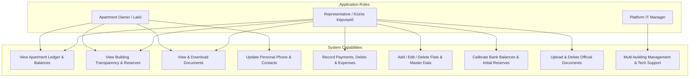

# Authentication & Permissions Specification

This document details the user roles, permission philosophy, credentials, and authentication mechanics of the **Társasházkezelő Portál**.

---

## 1. Role Definitions & Permissions

The platform supports a role-based authorization model designed for simplicity and security:



### 1.1 Representative (`role === "admin"`)
The **közös képviselő** is the authoritative manager of the building's records:
- Can view, create, edit, and delete transactions and expenses.
- Can create new apartments and edit master flat properties (ownership %, area, terrace, garages).
- Can calibrate building starting balances to match real bank statements.
- Can upload and delete official documents and contracts.
- Flat detail cards do not permit ad-hoc password resets to preserve resident credential privacy.
- Can toggle grid edit mode in the Arrears Matrix.

### 1.2 Apartment Owner (`role === "Owner"`)
Owners primarily **view, understand, and monitor** the records maintained for them:
- View current payment obligations and monthly fees for Common Cost (KK) and Renovation Fund (FA).
- Access bank transfer account numbers and exact payment reference strings with 1-click copy buttons.
- View complete historical statements for their apartment.
- View building financial transparency (total reserves, monthly performance margins, public arrears map).
- Download official condominium documents.
- **Limited write capability**: Can update their own contact information (phone number, emergency contact, tenant notes) and change their personal account password. Contact details render in a read-only state by default and only switch to input fields upon clicking the explicit **"Szerkesztés"** (pencil) button. Exiting without saving (clicking back, close `X`, or `Mégse`) discards drafts and immediately exits edit mode.

### 1.3 System Administrator / SuperAdmin (`role === "superadmin"`)
The platform superadministrator possesses complete overarching visibility across the entire system:
- **Global Hierarchy Diagram**: Can view which Condominium Representatives (KK) manage which condominiums, and inspect all flats branching out from each representative.
- **Full Associated Email Visibility**: Can inspect all email addresses attached to each apartment (including individual owner emails, secondary email arrays, and master flat emails) with 1-click clipboard copy actions.
- **Act-As Impersonation (`actAsUser` & `exitImpersonation`)**:
  - Clicking on any Condominium Representative seamlessly opens that representative's live dashboard and profile with full administrative editing privileges (*„olyan mintha beléptem volna a profiljába”*), allowing modifications to building master data, bank accounts, flat details, transactions, and info sections.
  - A persistent, high-visibility floating banner (`ImpersonationBanner.jsx`) remains pinned at the top (`z-[90]`), enabling an instantaneous, single-click return back to the SuperAdmin Center with zero disruption to the representative's account data.
  - Can also act as any apartment resident to inspect their balance views, bank transfer instructions, and statement history.
- **Multi-Building Scalability**: Designed to cleanly organize any number of representatives and apartments through expandable/collapsible tree branches, live real-time search, and tabular matrix views.

---

## 2. Default Accounts & Credentials (Batyu utca 21)

| Name | Role | Flat Num | Email | Default Password |
| :--- | :--- | :--- | :--- | :--- |
| **Rendszergazda** | `superadmin` (SuperAdmin) | `0` (System) | `superadmin@tarsashaz.hu` | `admin123` |
| **Baltay Benedek** | `admin` (Representative) | `0` (Admin) | `benedek.baltay@gmail.com` | `Csalad2001` |
| **Iván Fanni** | `Owner` | `Fsz 1` | `ivanfanni@gmail.com` | `lakas123` |
| **Baltay Benedek** | `Owner` (Resident) | `Fsz 2` | `benedek.baltay@gmail.com` | `Csalad2001` |
| **Bódi Anikó** | `Owner` | `Fsz 3` | `bancsa55@gmail.com` | `lakas123` |
| **Hóman Józsefné** | `Owner` | `I 4` | `iren.szgi@gmail.com` | `lakas123` |
| **Iván Noémi** | `Owner` | `I 5` | `ivannoemi@gmail.com` | `lakas123` |
| **Kaszonyi Bence** | `Owner` | `I 6` | `bencekaszonyi@gmail.com` | `lakas123` |
| **Dr. Cser László Gusztáv** | `Owner` | `II 7-8` | `laszlo.cser@uni-corvinus.hu` | `lakas123` |
| **Dr. Forrai Anna** | `Owner` | `II 9` | `forraianna@gmail.com` | `lakas123` |

### Strict Role Separation (KK vs. Lakó)
A közös képviselői (KK) és a lakói jogosultságok szigorúan szét vannak választva:
1. **Közvetlen bejelentkezés és automatikus szerepkör-felismerés**:
   - A felhasználó megadja az e-mail címét és jelszavát a bejelentkező felületen.
   - A rendszer kizárólag a beírt e-mail címből és az ahhoz regisztrált profilból állapítja meg a szerepkört:
     - **Közös Képviselői (`admin`) e-mail**: Közvetlenül a társasházi vezérlőpultra (`AdminView`) vagy portfólióba (`PortfolioView`) lép be. KK profilban nincs lakásváltási lehetőség (nincs "Saját Lakásom" gomb), kizárólag a kezelt épületek között navigálhat.
     - **Lakói / Tulajdonosi (`Owner`) e-mail**: Közvetlenül az albetét felületére (`TenantView`) lép be. Lakóként kizárólag a saját albetétei között válthat (ha több lakása van), KK felületre nem tud átlépni.
     - **Rendszergazda (`superadmin`) e-mail**: Közvetlenül a SuperAdmin központba (`SuperAdminView`) lép be.
2. **Különálló e-mail címek**:
   - Egy e-mail címhez vagy kizárólag KK adminisztrátori profil, vagy lakói albetét profil tartozhat.
   - Az Fsz 2. lakásból a közös képviselői e-mail cím (`benedek.baltay@gmail.com`) törlésre került, így a képviselő egy dedikált, különálló lakói e-mail címet állíthat be a lakásához a Törzsadatok felületen.

---

## 3. Authentication Mechanisms

### 3.1 Login Validation (`login`)
Client-side authentication validates against `state.users`:
```javascript
const foundUser = state.users.find(u => 
  u.email.toLowerCase().trim() === email.toLowerCase().trim() &&
  (u.pass === password || u.password === password)
);
```

### 3.2 Session Persistence ("Remember Me") & Firebase Auth Reconnection
- If "Remember Me" is checked:
  - `localStorage.setItem("tarsashaz_remember_me", "true")`
  - `localStorage.setItem("tarsashaz_logged_in_user", JSON.stringify(user))`
- On app launch, `AppContext` initializes `state.currentUser` from `tarsashaz_logged_in_user` if `tarsashaz_remember_me === "true"`.
- **Automatikus Firebase Auth újrahitelesítés (`ensureFirebaseAuth`)**:
  - Amikor a helyi munkamenet betöltődik, a háttérben automatikusan lefut a `signInWithEmailAndPassword`, amely hitelesíti a Firebase Auth SDK kapcsolatot is.
  - Ez garantálja, hogy a kliens `auth.currentUser != null` tokennel kommunikál a Firebase RTDB szerverrel, elkerülve az elutasított írási műveleteket és a szinkronizációs kiesést.

### 3.3 Strict Profile Isolation & Quick Login
- **Resident Privacy Protection**: Resident accounts are never listed in unauthenticated quick-login buttons on the login page. Residents must authenticate with their verified email and password.
- **Profile Switcher Isolation (`BuildingSelectorModal`)**: The profile switcher strictly queries only profiles belonging to the current user's authenticated email. A Common Representative (`admin`) cannot switch into other residents' accounts. For dual-role accounts (e.g. Baltay Benedek), only the Representative role and his own personal unit (`Fsz 2`) are switchable.
- **Admin Demo Access**: For rapid development and testing, a single Representative demo button is available on `LoginView`.

### 3.4 Hold-to-Peek Password
The password field includes an eye icon that shows plaintext password only while pressed:
- Desktop: `onMouseDown` / `onMouseUp` / `onMouseLeave`
- Mobile/Touch: `onTouchStart` / `onTouchEnd`

---

## 4. Password Reset & Recovery Flows

### 4.1 In-App Password Change (`ChangePasswordModal`)
Available from the user's settings modal (`ProfileModal`) for all authenticated users (both Common Representatives and Residents), as well as directly from the resident dashboard header.
Key UX and Security rules:
1. **No Old Password Required**: Because the user is already authenticated in an active session, they do **not** need to re-enter their old password.
2. **Simplified 2-Field Entry**: The modal presents exactly two fields:
   - New password (minimum 4 characters)
   - Confirm new password
3. **Validation & Synchronization**: Validates that both entries match and meet the 4-character minimum. Upon saving, updates the user credentials in `state.users`, `state.currentUser`, `tarsashaz_logged_in_user`, and synchronizes to Firebase RTDB and LocalStorage.

### 4.2 Self-Service Password Recovery & Removal of KK Reset Option
- **KK Reset Option Removed**: The Common Representative (KK) no longer has any option or button to reset a flat's password back to the default (`lakas123`). This eliminates security vulnerabilities where an admin could overwrite private resident passwords.
- **Self-Service Forgot Password (`ForgotPasswordModal`)**: If a resident or any user forgets their password, they must use the self-service **"Elfelejtettem a jelszavam"** option available on the login screen.
- **Password Reset Link**: A reset link / email is dispatched to the user's registered email address, allowing secure self-service password restoration.

### 4.3 Deep Link Reset Activation (`ResetPasswordModal`)
On initial mount, `App.jsx` checks URL search parameters:
```javascript
const params = new URLSearchParams(window.location.search);
const token = params.get('reset_token');
const email = params.get('email');
if (token && email) {
  setResetPassData({ email, token }); // Automatically displays ResetPasswordModal
}
```
Updating the password immediately saves the new credentials to the user record in `state.users` and synchronizes to Firebase RTDB and LocalStorage.

---

## 5. Security Hardening & Operating Mandates

> [!CAUTION]
> ### 🛑 SZABÁLY 3: SZIGORÚ ADATBÁZIS-MÓDOSÍTÁSI ÉS JÓVÁHAGYÁSI SZABÁLY
> A Firebase-ben vagy a honlapon tárolt adatokba belenyúlni szigorúan tilos! Csak a felhasználó kifejezett, előzetes engedélyével szabad bármilyen rekordot (felhasználót, jelszót, lakást vagy egyenleget) módosítani.

> [!IMPORTANT]
> ### 🔒 SZABÁLY 4: ADATBIZTONSÁG ÉS FELTÖRHETETLENSÉG
> A platform hitelesítési és jogosultságkezelési mechanizmusait folyamatosan erősíteni kell:
> - **Plaintext jelszavak megszüntetése**: Javasolt a jelszavak tárolását kizárólag a Firebase Authentication Identity Platformra bízni, és eltávolítani a nyers jelszavakat a `condo_state` és `users` objektumokból.
> - **Felhőbeli RBAC**: A Firebase RTDB hozzáférési szabályait (`database.rules.json`) szerepkörökhöz kell kötni, hogy illetéktelen kliens ne írhassa felül mások adatait.
> - Részletes fenyegetettség-elemzés és javaslatcsomag: lásd [docs/SECURITY_AND_DATA_PROTECTION.md](file:///c:/Users/bened/Documents/tarsasAPP/docs/SECURITY_AND_DATA_PROTECTION.md).

> [!NOTE]
> ### 🌐 KÉTNYELVŰSÉG ÉS DOKUMENTÁCIÓ (SZABÁLY 1 ÉS 2)
> - Minden autentikációval és jogosultsággal kapcsolatos feliratnak (hibaüzenetek, modalok, űrlapok) kétnyelvűnek (`hu` és `en`) kell lennie.
> - Bármely hitelesítési vagy engedélyezési logika változtatása kötelezően dokumentálandó ezen fájlban és az `AGENT.md`-ben.

