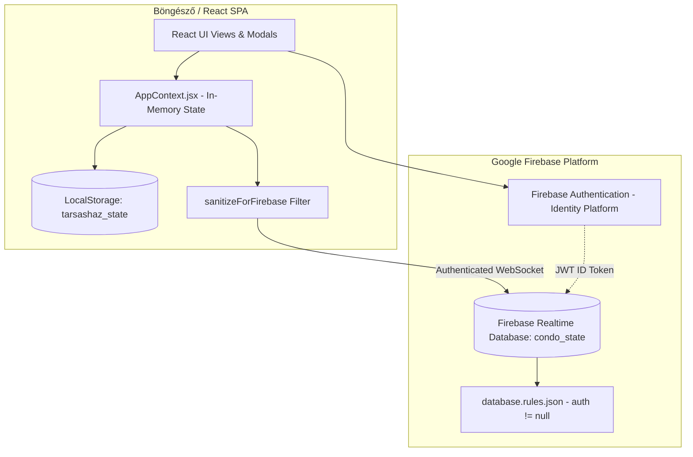

# Security, Data Protection & Inviolability Specification

This document details the security architecture, authorization principles, vulnerability analysis, and actionable hardening recommendations for the **Társasházkezelő Portál** to ensure enterprise-grade data protection and system inviolability.

---

## 1. The Core Security Mandate

> [!CAUTION]
> ### 🔒 ADATBIZTONSÁGI ÉS FELTÖRHETETLENSÉGI ALAPSZABÁLY (RULE 4)
> **MINDIG ARRA KELL TÖREKEDNI, HOGY AZ ADATBIZTONSÁG ÉS A FELTÖRHETETLENSÉG ELŐRE HALADJON.**
> 1. **Proaktív sebezhetőség-feltárás**: Bármilyen fejlesztés vagy architektúrális vizsgálat során felismert gyenge pontot, kockázatot vagy potenciális támadási felületet kötelező azonnal dokumentálni és konkrét mérnöki javaslatot tenni annak elhárítására.
> 2. **Szigorú adatvédelem (Privacy-First)**: Lakók személyes adatai (jelszavak, e-mail címek, telefonszámok, pénzügyi egyenlegek) soha nem szivároghatnak ki illetéktelen személyekhez.
> 3. **Megváltoztathatatlan felügyelet (Tamper-Resistance)**: A könyvelési tételek, induló egyenlegek és tulajdonosi előírások nem módosulhatnak jogosulatlanul vagy véletlenül.

---

## 2. Current Security Architecture



### 2.1 Present Defensive Controls
1. **Firebase Authentication Enforced**:
   - `database.rules.json` megköveteli az `auth != null` feltételt mind az olvasási (`.read`), mind az írási (`.write`) műveletekhez.
   - Névtelen vagy jogosulatlan hálózati kérések azonnali `PERMISSION_DENIED` hibát kapnak a felhőben.
2. **Payload Schema & Existence Validation**:
   - A `.write` szabály ellenőrzi: `newData.exists() && newData.hasChildren(['buildings', 'users', 'lastUpdated'])`. Üres vagy csonka adatcsomag nem tudja felülírni a felhő állapotot.
3. **Payload Sanitization (`sanitizeForFirebase`)**:
   - A kliens szigorúan eltávolítja az `undefined` értékeket és garantálja a tömb típusok konzisztenciáját, megelőzve az RTDB típusösszeomlásait.
4. **Permanent Vault (Tombstone Tracking)**:
   - Megakadályozza a törölt tételek véletlen újraéledését elosztott offline hálózati szinkronizáció esetén.
5. **Kliensoldali Profilizoláció**:
   - A lakó nézet (`TenantView`) csak a saját lakásának egyenlegeit jeleníti meg; a profilváltó modal (`BuildingSelectorModal`) kizárólag a bejelentkezett e-mail címhez tartozó profilokat engedi kiválasztani.
6. **HTTP Biztonsági Fejlécek (`firebase.json`)** (Implementálva):
   - `X-Frame-Options: SAMEORIGIN` (Clickjacking védelem).
   - `X-Content-Type-Options: nosniff` (MIME sniffing elleni védelem).
   - `Referrer-Policy: strict-origin-when-cross-origin`.
   - `Permissions-Policy: camera=(), microphone=(), geolocation=()`.
7. **Kliensoldali 2 MB-os Fájlméret és MIME Whitelist Védelem** (Implementálva):
   - `DocumentsModal.jsx` és `UniversalTransactionModal.jsx` szigorúan ellenőrzi a fájlméretet (max 2 MB) a Base64 konverzió előtt. Megvédi a böngészőt a LocalStorage kvótatúllépéstől (`QUOTA_EXCEEDED_ERR`).
   - Szigorú típus-whitelist és kiterjesztés-ellenőrzés (.pdf, .jpg, .png, .xlsx, .docx).
8. **Brute-Force és Rate-Limiting Védelem** (Implementálva):
   - `LoginView.jsx` számlálja a sikertelen belépési kísérleteket. 5 sikertelen próbálkozás után a felület 30 másodpercre zárolódik, letiltva az automatizált jelszótörést. Kétnyelvű visszaszámláló tájékoztatja a felhasználót.
9. **Automatikus Firebase Auth Munkamenet-újrahitelesítés (`ensureFirebaseAuth`)** (Implementálva):
   - Ha a böngésző munkamenetet tölt be a helyi tárhelyből (`tarsashaz_remember_me`), a háttérben automatikusan újra bejelentkezteti a Firebase Auth klienst a megőrzött felhasználói hitelesítő adatokkal. Ez megakadályozza az érvénytelen `auth == null` kapcsolatot és a csendes `PERMISSION_DENIED` hibákat felhőbe íráskor.
10. **Kanonikus Adatcsomag-generálás és Törlésvédelem (`createCloudPayload` & Anti-Wipe Guard)** (Implementálva):
    - Minden RTDB mentés a központi `createCloudPayload` függvényen halad át, amely egységesen garantálja a gyökérelemek és az aktív épület mezőinek teljességét.
    - Új vagy inkognitó ablakok (`revision: 0`) nem hozhatnak létre üres alapállapotot a felhőben; az inicializálás kizárólag érvényes felülvizsgálati számmal és időbélyegzővel engedélyezett (`s.revision > 0 && s.lastUpdated > 0`).
11. **Valós Idejű Szinkronizációs Állapot és Hibaátláthatóság (`cloudSyncStatus` & `cloudSyncError`)** (Implementálva):
    - A rendszer valós időben jelzi a mentés állapotát (`synced`, `syncing`, `error`). Hibás felhőírás esetén a felület nem jelenít meg hamis "Naprakész" státuszt, hanem figyelmeztető jelvénnyel (`CloudSyncBadge.jsx`) és egykattintásos kényszerített szinkronizálással (`forceSyncLocalToCloud`) támogatja az azonnali helyreállítást.

---

## 3. Vulnerability Analysis & Identified Weak Points (Gyenge Pontok)

Az alapos biztonsági audit során feltárt kockázatok és gyenge pontok:

### ⚠️ Gyenge Pont 1: Plaintext Jelszótárolás a Szinkronizált Állapotban
- **Leírás**: A `users` tömb a felhőben (`condo_state/users`) és a kliensoldali LocalStorage-ben (`tarsashaz_state`) nyers szövegként tartalmazza a felhasználók jelszavait (`pass` és `password` mezők).
- **Kockázat**: Bár a Firebase Auth kezeli a jelszavakat titkosítva, a `condo_state` teljes állapotként lejut minden bejelentkezett kliensre. Egy hozzáértő felhasználó a böngésző Console-jából vagy DevTools Storage paneljéből kiolvashatja az összes többi lakó jelszavát.
- **Súlyosság**: **KRITIKUS / MAGAS**.

### ⚠️ Gyenge Pont 2: Nem Szerepkör-alapú Írási Jogosultság a Felhőben (Lack of RBAC in RTDB)
- **Leírás**: A `database.rules.json`-ben jelenleg minden bejelentkezett felhasználó (`auth != null`) írhatja a `condo_state` csomópontot:
  ```json
  ".write": "auth != null && newData.exists() && newData.hasChildren(['buildings', 'users', 'lastUpdated'])"
  ```
- **Kockázat**: Ha egy egyszerű lakó bejelentkezik a saját fiókjával, a birtokában lévő Firebase Auth JWT tokennel egy tetszőlegesen összeállított WebSocket csomaggal felülírhatja a teljes könyvelést vagy más lakások adatait. A szerepkör-ellenőrzés (`role === 'admin'`) jelenleg kizárólag a React UI rétegben fut le.
- **Súlyosság**: **MAGAS**.

### ⚠️ Gyenge Pont 3: Monolitikus Adatszerkezet (Nincs Fizikai Adatizoláció)
- **Leírás**: A teljes rendszerállapot (minden épület, lakás, tranzakció, felhasználó) egyetlen `condo_state` csomópont alatt található.
- **Kockázat**: Nem valósul meg a bérlők/lakások közötti szeparáció (Multi-tenancy isolation). Ha a jövőben több társasház lesz a rendszerben, az „A” ház lakója technikailag megkapja a „B” ház adatait is a kliens oldalon.
- **Súlyosság**: **KÖZEPES / HOSSZÚ TÁVON MAGAS**.

### ⚠️ Gyenge Pont 4: Base64 Fájlfeltöltések a Realtime Database-be
- **Leírás**: A csatolt dokumentumok és számlamellékletek Base64 kódolású stringként tárolódnak a `documents` és `attachments` mezőkben közvetlenül a JSON fában.
- **Kockázat**:
  1. A LocalStorage maximális kapacitása (~5 MB) gyorsan betelik, ami `QUOTA_EXCEEDED_ERR` hibát és adatvesztést/mentési hibát okoz a böngészőben.
  2. A Firebase RTDB egyetlen csomópontra vonatkozó méretkorlátja és hálózati sávszélessége feleslegesen terhelődik.
- **Súlyosság**: **KÖZEPES**.

### ⚠️ Gyenge Pont 5: Hiányzó Brute-Force és Rate-Limiting Védelem
- **Leírás**: Nincs korlátozva az egymást követő hibás jelszópróbálkozások száma.
- **Kockázat**: Automatizált scripttel jelszótörési kísérlet (brute-force vagy credential stuffing) hajtható végre a lakói fiókok ellen.
- **Súlyosság**: **KÖZEPES**.

### ⚠️ Gyenge Pont 6: Kliensoldali Fájlméret-korlátozás Hiánya (LocalStorage DoS Kockázat)
- **Leírás**: A `DocumentsModal.jsx` és `UniversalTransactionModal.jsx` nem ellenőrzi a kiválasztott fájlok maximális méretét (pl. 2 MB limit) a Base64 konverzió előtt.
- **Kockázat**: Ha a felhasználó egy nagyobb PDF-et vagy fényképet (pl. 15–20 MB) tölt fel, a Base64 string azonnal túllépi a böngésző 5 MB-os `localStorage` kvótáját, ami `QUOTA_EXCEEDED_ERR` hibát és az állapotmentés megbénulását okozza.
- **Súlyosság**: **MAGAS**.

### ⚠️ Gyenge Pont 7: Fájlkiterjesztés és MIME Típus Szűrés Hiánya
- **Leírás**: A dokumentum- és számlafeltöltés nem alkalmaz szigorú whitelistet az engedélyezett fájlformátumokra (csak PDF, JPG, PNG, XLSX).
- **Kockázat**: Potenciálisan kártékony (pl. HTML vagy SVG beágyazott scriptek) feltöltése és megnyitása a felületen.
- **Súlyosság**: **KÖZEPES**.

### ⚠️ Gyenge Pont 8: Hiányzó HTTP Biztonsági Fejlécek (`firebase.json`)
- **Leírás**: A `firebase.json` jelenleg csak `Cache-Control` fejlécet konfigurál az `index.html`-hez. Hiányoznak az alapvető védelmi fejlécek (`X-Frame-Options`, `X-Content-Type-Options`, `Referrer-Policy`, `Content-Security-Policy`).
- **Kockázat**: Az alkalmazás beágyazható lehet külső iframe-be (Clickjacking támadás), és nincs védve a MIME sniffing ellen.
- **Súlyosság**: **KÖZEPES**.

---

## 4. Actionable Security Hardening Proposals (Javaslatok a Feltörhetetlenséghez)

A feltörhetetlen és biztonságos architektúra elérésére javasolt konkrét fejlesztési lépések:

### 🛡️ Javaslat 1: Jelszavak Teljes Kigyomlálása az Állapotból (Zero Plaintext Passwords)
- **Megoldás**:
  1. A jelszavakat kizárólag a **Firebase Authentication Identity Platform** tárolhatja és ellenőrizheti (ahol a jelszavak a Google scrypt algoritmusával vannak hashelve és sózva).
  2. A `state.users` objektumokból, a `defaultData.js`-ből és az RTDB `condo_state/users` fájlból véglegesen törölni kell a `pass` és `password` mezőket!
  3. A kliens oldalon a felhasználó létezését és jogosultságát a Firebase Auth `uid` vagy verified e-mail címe azonosítja.

### 🛡️ Javaslat 2: Szerepkör-alapú Hozzáférés-szabályozás (RBAC) a Firebase RTDB Szabályokban
- **Megoldás**:
  A Firebase szabályokban ellenőrizni kell a felhasználó adminisztrátori jogosultságát:
  ```json
  {
    "rules": {
      "condo_state": {
        ".read": "auth != null",
        ".write": "auth != null && root.child('condo_state/users').child(auth.uid).child('role').val() === 'admin' || auth.token.email === 'benedek.baltay@gmail.com' || auth.token.email === 'superadmin@tarsashaz.hu'"
      }
    }
  }
  ```
  *(Megjegyzés: vagy Firebase Custom Claims bevezetése Cloud Functions segítségével: `auth.token.role === 'admin'`)*.
  Így egy illetéktelen lakó még szándékos API hívással sem tudja felülírni a könyvelést!

### 🛡️ Javaslat 3: Firebase Cloud Storage Bevezetése a Dokumentumokhoz
- **Megoldás**:
  1. A fájlokat és számlamellékleteket ne a JSON fában (Base64), hanem a Firebase Cloud Storage-ban (`tarsashaz-cfe5d.firebasestorage.app`) tároljuk.
  2. Az RTDB-ben csak a fájl neve, mérete, feltöltés dátuma és a biztonságos letöltési URL vagy storage path szerepeljen.
  3. Firebase Storage Security Rules bevezetése: csak hitelesített felhasználók tölthessék le az épület dokumentumait.

### 🛡️ Javaslat 4: Granuláris Adatbázis Particionálás (Multi-Building Isolation)
- **Megoldás**:
  Az adatbázis fa átszervezése az alábbi hierarchiára:
  - `/buildings/{buildingId}/public_info` (minden lakó olvashatja)
  - `/buildings/{buildingId}/flats/{flatNum}` (csak az adott lakás tulajdonosa és az admin olvashatja)
  - `/buildings/{buildingId}/accounting` (csak a közös képviselő és számvizsgáló olvashatja/írhatja)
  - `/users/{userId}` (személyes profiladatok, szigorúan `auth.uid === userId`)

### 🛡️ Javaslat 5: Firebase App Check Aktiválása
- **Megoldás**:
  Google reCAPTCHA Enterprise / App Check integráció a webes kliensben. Ez garantálja, hogy kizárólag a hivatalos weboldalról (`https://tarsashaz-cfe5d.web.app`) érkező böngészőből lehessen kérést intézni az adatbázishoz; minden külső bot, curl kérés vagy script azonnal elutasításra kerül.

### 🛡️ Javaslat 6: Rate Limiting & Account Lockout
- **Megoldás**:
  Kliensoldali késleltetés (exponential backoff) és Firebase Auth beépített védelmének kihasználása: 5 hibás próbálkozás után 60 másodperces zárolás, megelőzve a brute-force támadásokat.

### 🛡️ Javaslat 7: Fájlfeltöltési Korlátok és MIME Whitelist
- **Megoldás**:
  1. Maximális fájlméret korlátozás bevezetése a feltöltési dialógusokban: max. 2 MB (toast figyelmeztetéssel, ha ennél nagyobb fájlt próbálnak feltölteni).
  2. Szigorú típus-whitelist: kizárólag PDF (`.pdf`), képek (`.jpg`, `.jpeg`, `.png`, `.webp`) és táblázatok (`.xlsx`) engedélyezése.

### 🛡️ Javaslat 8: HTTP Biztonsági Fejlécek Beállítása (`firebase.json`)
- **Megoldás**:
  A Firebase Hosting konfiguráció kibővítése a legfontosabb védelmi fejlécekkel:
  - `X-Frame-Options: SAMEORIGIN` (Clickjacking elleni védelem)
  - `X-Content-Type-Options: nosniff` (MIME sniffing elleni védelem)
  - `Referrer-Policy: strict-origin-when-cross-origin`

### 🔒 Javított Kritikus Sebezhetőség: Hardcoded Jelszó-Fallback Eltávolítása (2026.10.12)
- **Hiba leírása**: A bejelentkezési logikában (`AppContext.jsx` -> `login()`) korábban létezett egy hibakezelő blokk, amely adminisztrátori e-mail cím esetén egy beégetett jelszólistával próbálkozott (`altPasses = [cleanPass, "Csalad20011", "Csalad2001"]`). Ha a felhasználó bármilyen véletlenszerű vagy hibás jelszót adott meg, a háttérben a beégetett jelszó sikeres hitelesítést váltott ki a Firebase Auth-nál, a rendszer pedig tévesen sikeresnek nyilvánította a bejelentkezést!
- **Elhárítás**:
  1. A beégetett jelszólista és a hibás jelszavas bypass teljesen el lett távolítva.
  2. Bármilyen fiók esetén, ha a megadott jelszó téves (`auth/wrong-password` vagy `auth/invalid-credential`), a rendszer azonnal elutasítja a bejelentkezést (`{ success: false, error: "Hibás e-mail cím vagy jelszó!" }`).
  3. Semmilyen körülmények között nem történhet sikeres bejelentkezés a felhasználó által ténylegesen megadott pontos és érvényes jelszó nélkül.

---

## 5. Security Checklist for Development Sessions

Minden új feladat vagy módosítás során ellenőrizendő:
- [ ] Tilos új plaintext jelszót vagy érzékeny titkot a kódba vagy a szinkronizált JSON állapotba menteni!
- [ ] Bármilyen új végpont, állapotfrissítő vagy űrlap ellenőrzi-e a felhasználó szerepkörét és jogosultságát?
- [ ] Nem sérül-e a szigorú adatbázis-módosítási tiltás (Rule 3) éles környezetben?
- [ ] A bemeneti mezők (nevek, összegek, megjegyzések) megfelelően validáltak és fertőtlenítettek-e (XSS és injection elleni védelem)?
